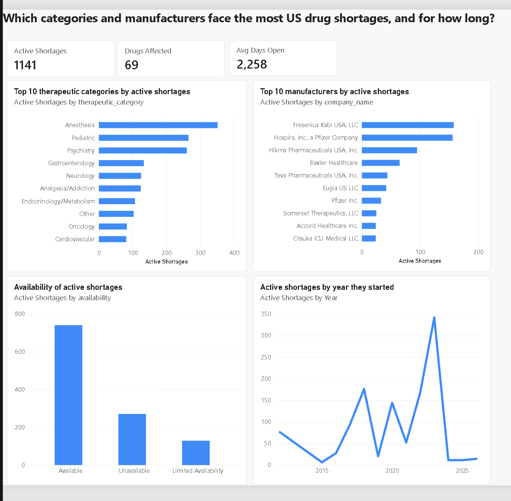

# US Drug Shortages Dashboard | Power BI

**Question:** Which therapeutic categories and manufacturers face the most US drug shortages, and for how long?


[Download the full dashboard as PDF](images/dashboard.pdf)


## Key insights
- **1,141 active shortage listings** covering **69 distinct drugs** (FDA data, October 2026).
- **Anesthesia, Pediatric and Psychiatry** are the most affected therapeutic categories.
- **Fresenius Kabi** (158) and **Hospira, a Pfizer company** (156) have the most active shortage listings. Together they account for over a quarter of the total.
- The average active shortage has been open for **about 2,258 days (around 6 years)**.
- **342 of today's active shortages started in 2023**, more than in any other year.
- **400 listings (35%)** are Unavailable or Limited Availability.

## Data
- Source: [openFDA Drug Shortages](https://open.fda.gov/apis/drug/drugshortages/), U.S. Food and Drug Administration, public domain (CC0).
- Snapshot: 1,582 shortage records, flattened to 2,386 rows (one row per therapeutic category).
- Preparation: dates converted to ISO format, availability typos fixed, missing values labelled "Not reported".
- Limitation: the FDA removes resolved shortages after about 6 months, so resolution time can't be measured reliably.

## Skills demonstrated
- Power Query data loading and type handling
- DAX measures: `CALCULATE`, `DISTINCTCOUNT`, `AVERAGEX`, `DATEDIFF`
- Top N filtering and report design
- Power BI Project format (.pbip) for version control

## DAX measures
```dax
Active Shortages = CALCULATE(DISTINCTCOUNT(Shortages[shortage_id]), Shortages[status] = "Current")
Drugs Affected   = CALCULATE(DISTINCTCOUNT(Shortages[generic_name]), Shortages[status] = "Current")
Avg Days Open    = ROUND(AVERAGEX(CALCULATETABLE(VALUES(Shortages[shortage_id]), Shortages[status] = "Current"),
                   CALCULATE(DATEDIFF(MIN(Shortages[initial_posting_date]), TODAY(), DAY))), 0)
```

## How to open
1. Install the free [Power BI Desktop](https://www.microsoft.com/power-bi/desktop) (Windows).
2. Clone or download this repository (**Code → Download ZIP**, then unzip).
3. Open `report/fda-shortages.pbip` in Power BI Desktop.
4. Point the report to the data on your computer:
   - Go to **Home → Transform data → Edit parameters**.
   - Set `DataFolder` to the full path of this repository's `data` folder, ending with `\`.
     Example: `C:\Users\YourName\Downloads\powerbi_fda_drug_shortages\data\`
   - Click **OK**, then **Apply changes**.

The data file `data/fda_drug_shortages.csv` is included in this repository.
To get the newest data, download it from [openFDA Drug Shortages](https://open.fda.gov/apis/drug/drugshortages/).

## Next steps
- Add a date table and star-schema data model
- Add a detail page with drill-through by drug
